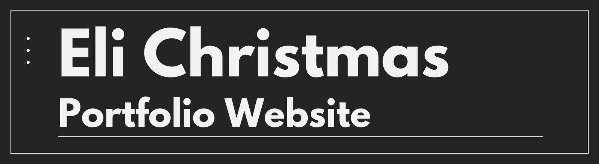
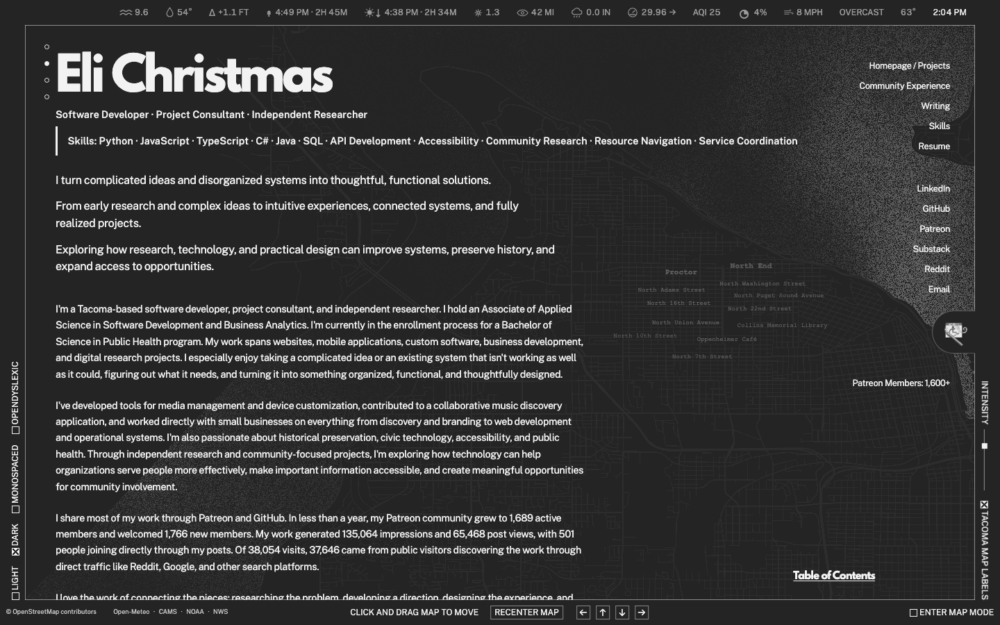
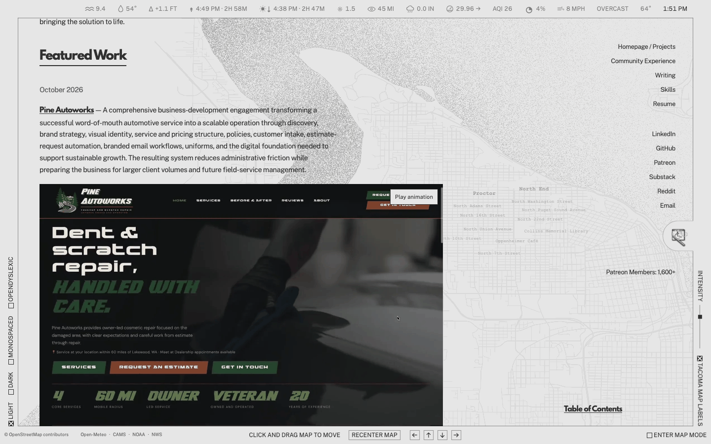
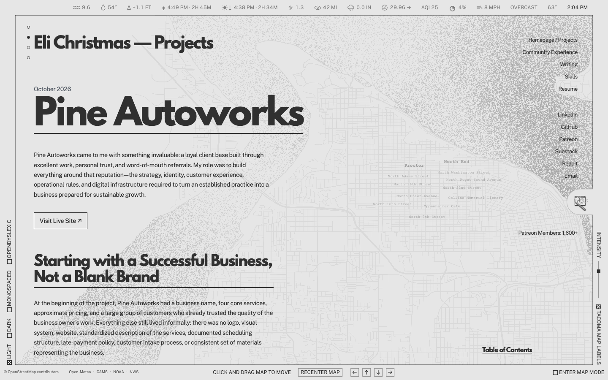
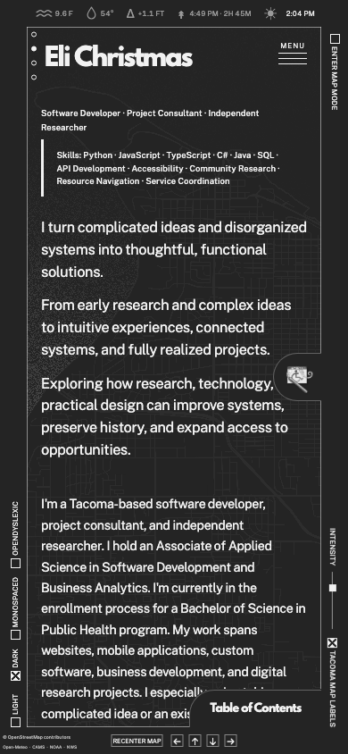
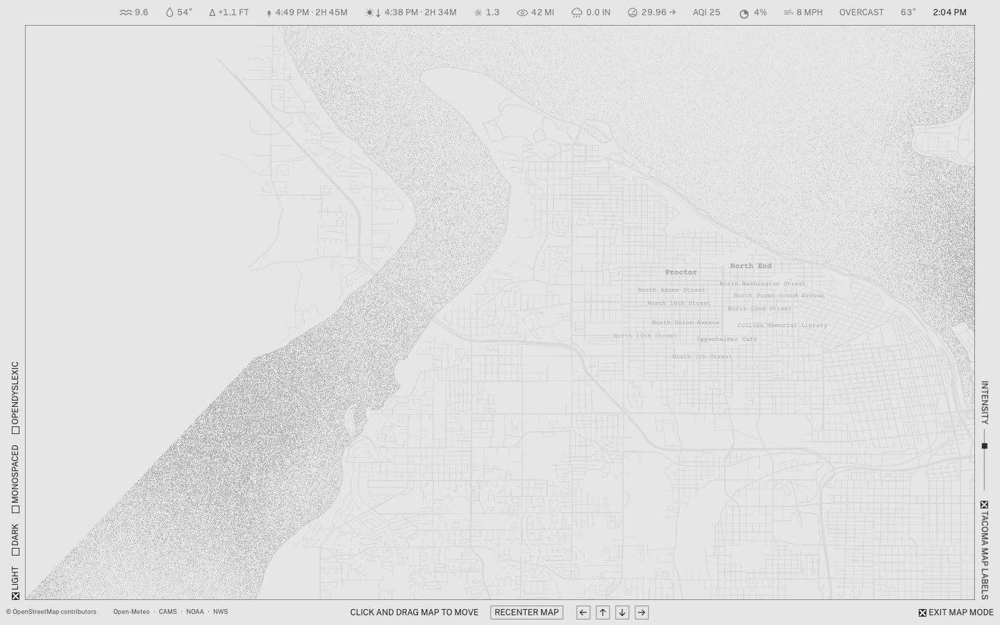
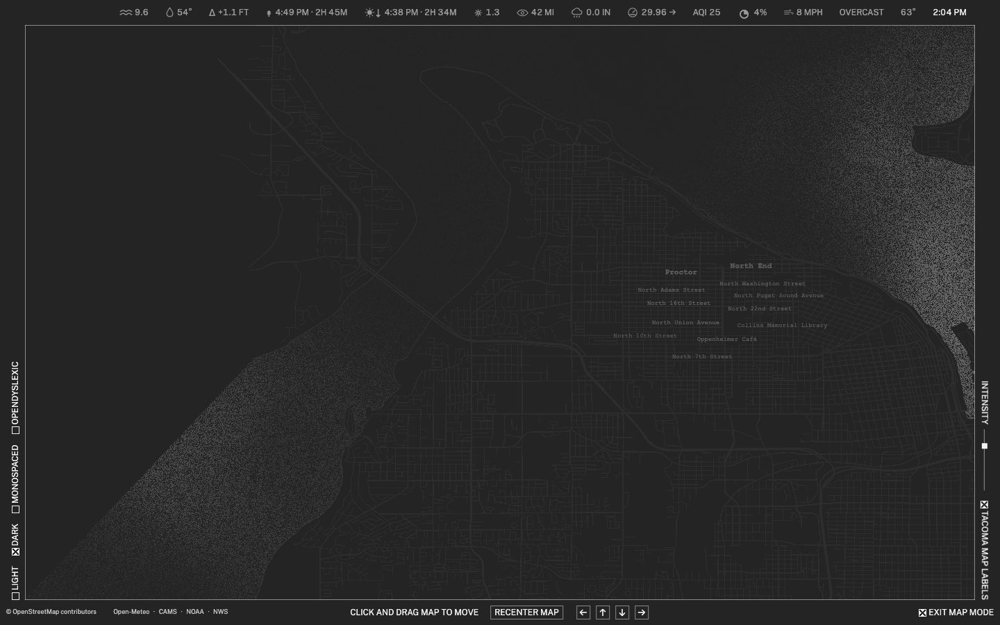
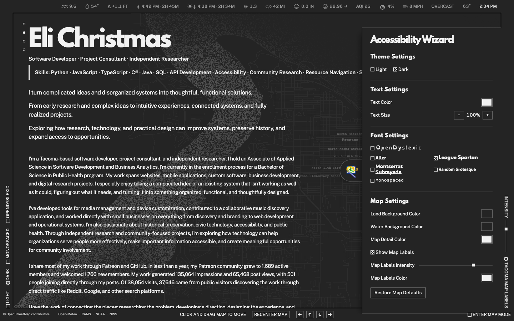
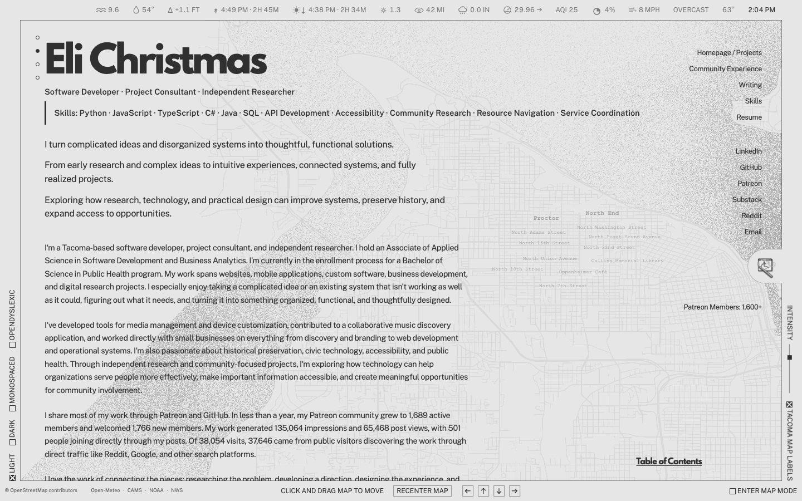
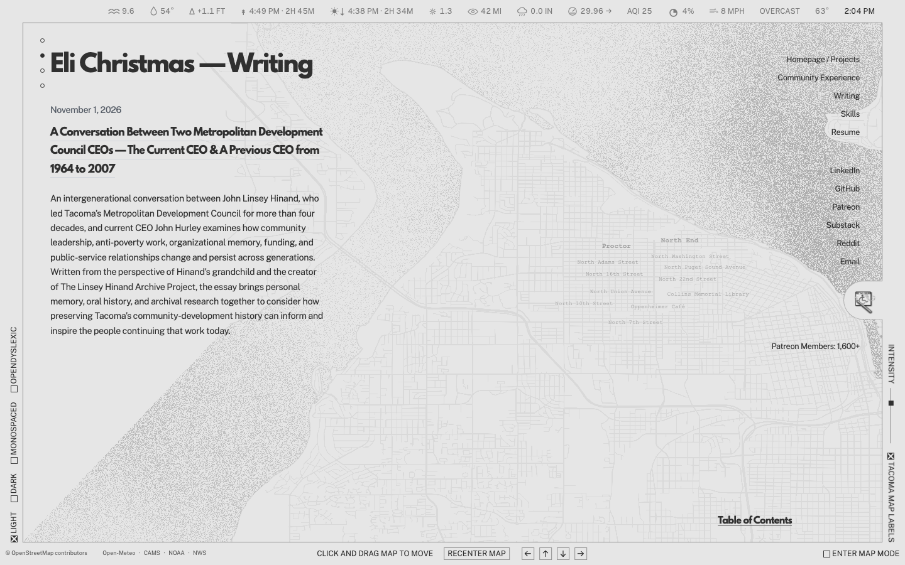

<h1 align="center">
  
</h1>

  A living portfolio for my software development, project consulting, research, community work, and writing. It brings detailed project stories together with an interactive Tacoma map and viewing controls that let visitors make the site more comfortable to read.

  &nbsp;&nbsp;&nbsp;&nbsp;&nbsp;&nbsp;&nbsp;&nbsp;

  <a href="https://elichristmas.dev/"><strong>Open Eli Christmas Portfolio Website</strong></a>

  
   
  The homepage in dark, light, dark with monospaced type, and dark with OpenDyslexic type, with Tacoma and current local conditions in view.

## Table of Contents

Open Table of Contents

 

- [About the Project](#about-the-project)
- [What the Website Includes](#what-the-website-includes)
- [Explore the Projects](#explore-the-projects)
- [The Tacoma Map and Local Conditions](#the-tacoma-map-and-local-conditions)
- [Accessibility and Appearance](#accessibility-and-appearance)
- [Community Experience and Writing](#community-experience-and-writing)
- [How It Was Built](#how-it-was-built)
- [Local Development](#local-development)
- [Data, Media, and Reuse](#data-media-and-reuse)
- [Links from the Portfolio](#links-from-the-portfolio)

## About the Project

I wanted my portfolio to show more than a grid of finished projects. My work often begins with research, a messy system, or a community need that does not fit neatly into one screenshot. Each project page gives me room to explain the starting point, the decisions I made, what I built, and what comes next. The homepage connects that work to my experience in software, media tools, accessibility, preservation, and service coordination.

Tacoma is part of that story, so the site has a movable map of the city behind the content rather than a generic decorative background. A slim status bar brings in current local conditions. The frame, typography, map detail, and reading controls are meant to make the website feel personal while still letting visitors choose a simpler or more comfortable view.

The live website is [elichristmas.dev](https://elichristmas.dev/).

## What the Website Includes

- **Featured Work:** in-depth pages for selected software, design, research, and business projects, with screenshots, video, captions, and links to live work where available.
- **More Projects:** collections for the Jellyfin ecosystem, media organization and preservation, Innioasis Y1 work, and technical studies.
- **Community Experience:** separate pages describing service coordination, accessibility, family resource support, and related work.
- **Writing:** essays and research-oriented writing with their own readable pages.
- **Skills and résumé:** a direct route from the homepage to the skills section and a PDF résumé.
- **Tacoma map:** a draggable, keyboard-accessible map with labels, a recenter control, and a dedicated map mode.
- **Local conditions:** Tacoma weather, air quality, tide, sunlight, and alert information, with links to the data providers.
- **Viewing controls:** light and dark themes, font choices, text size, colors, map settings, and OpenDyslexic or monospaced type.

## Explore the Projects

The homepage groups projects by the kind of work they represent. Featured entries appear first; the collections below provide another route into related work. A table of contents can jump directly to a project or section. On narrower screens, the site uses a compact menu and a responsive content layout.

The dark-mode walkthrough follows the homepage from the introduction through Featured Work, the grouped project collections, community reach, and the Skills section at the bottom. It shows how the full catalog sits over the Tacoma map before opening any individual project.

  
   
  A full scroll through the homepage in dark mode.

Project pages combine the story with media relevant to each section. Images and videos have descriptive captions, and the media viewer provides a larger view with navigation through the available material. When a project has a public destination, a **Visit Live Site** link appears near its introduction.

  
   
  Moving from Featured Work into a detailed project story.

  
   
  Featured Work places the project description beside its visual record.

  
   
  The Pine Autoworks case study shows the format used for individual projects.

  
   
  The same portfolio on a narrow mobile screen.

## The Tacoma Map and Local Conditions

The background map uses bundled Tacoma geometry and label data derived from OpenStreetMap. The site renders it with canvas and WebGL, then lets visitors drag or use the directional buttons to move it. Keyboard users can focus the map, move it with the arrow keys, and press **Home** to recenter. A dedicated map mode gives the map more room without the project text over it.

  
   
  The dedicated map mode opens up the Tacoma shoreline and neighborhood labels in light mode.

  
   
  The same map in dark mode, with the water and streets visible against the original dark palette.

The map images keep the site's original colors and stippled water, with the pointer over the map to reveal labels.

The status bar uses browser requests for current Tacoma conditions. It includes weather and air-quality information from Open-Meteo, Commencement Bay observations and predictions from NOAA, and weather alerts from the National Weather Service. The displayed values can change or become unavailable when an upstream service cannot answer; the portfolio content itself remains readable.

The status bar has 14 local indicators, plus an alert when a matching weather warning is active. It directly calls three APIs: Open-Meteo for weather and air quality, NOAA for tides and bay observations, and the National Weather Service for alerts. Tide requests repeat every 6 minutes; weather, air quality, and alert requests repeat every 15 minutes. The local clock updates every 15 seconds, while the sun and tide countdowns update each minute.

## Accessibility and Appearance

The **Accessibility Wizard** brings the viewing options into one panel. Visitors can choose a light or dark theme, change text color and size, select a typeface, adjust map colors and label intensity, or restore map defaults. The site also has a visible skip link on keyboard focus, labeled controls, keyboard map movement, and reduced-motion styling. Appearance preferences are saved in the browser's local storage.

These controls are part of the website's design, not a claim that one preset works for every visitor. I wanted people to be able to adapt the presentation to their own reading needs.

  
   
  The Accessibility Wizard and its light and dark themes.

  
   
  Text, font, color, and map controls in one place.

  
   
  The homepage in the light theme.

## Community Experience and Writing

The portfolio includes work that is not a conventional software release. **Community Experience** documents practical service, accessibility, and resource-navigation work. **Writing** provides a place for longer-form research and reflection. Both sections use the same navigation and appearance controls as the project pages.

  
   
  The Writing section keeps longer pieces separate from the project catalog.

## How It Was Built

The public site is built with HTML, CSS, and browser JavaScript. Project copy and media references are organized as data, while a shared project page displays the selected entry. The Tacoma map is drawn with canvas and WebGL from bundled geometry and label data. Current local conditions come from public data services in the visitor's browser.

The website is hosted on Cloudflare. Its source and development tools are maintained separately from this informational repository.

## Local Development

I develop and preview the website in a separate private source repository. During local development I serve the site in a browser, check the navigation and project pages, and validate the public site before an update goes live.

This repository documents the finished experience; it does not contain the website source or the tools needed to run a local copy. To explore the current site, visit [elichristmas.dev](https://elichristmas.dev/).

## Data, Media, and Reuse

Map data is credited to [OpenStreetMap contributors](https://www.openstreetmap.org/copyright). The status bar links to [Open-Meteo](https://open-meteo.com/), [Copernicus Atmosphere Monitoring Service](https://ads.atmosphere.copernicus.eu/), [NOAA Tides & Currents](https://tidesandcurrents.noaa.gov/stationhome.html?id=9446484), and the [National Weather Service](https://www.weather.gov/documentation/services-web-alerts). Project pages may also show work and media created for clients or collaborators; those materials remain associated with their respective projects.

The README screenshots and GIFs were captured from the running local portfolio on November 10, 2026. They show real pages and controls, while live weather and project content may change. This repository does not currently include a project-wide license file.

## Links from the Portfolio

- [Live portfolio](https://elichristmas.dev/)
- [Projects](https://elichristmas.dev/#featured-work)
- [Community Experience](https://elichristmas.dev/community-experience.html)
- [Writing](https://elichristmas.dev/notes.html)
- [GitHub](https://github.com/mp3li)
